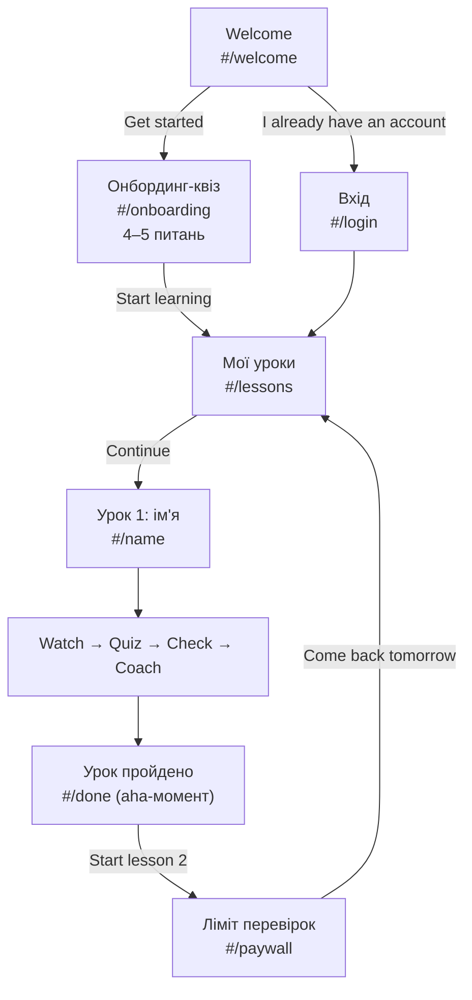

# ILY — шлях користувача і воронка

Як людина проходить від першого екрана до уроків і пейволу. Екрани реалізовані у
[frontend/src/screens/](frontend/src/screens/), питання онбордингу — у
[frontend/src/funnel.ts](frontend/src/funnel.ts). Вхід і аналітика — моки (`HACK:`): бекенду для
них немає, див. CLAUDE.md › Won't. Вибору тарифу й оплати в застосунку немає.

## Схема

Premium продаємо в одному місці — на **пейволі після aha-моменту** (`#/paywall`): людина вже
показала ім'я жестами, а безкоштовні перевірки на сьогодні закінчились. Кнопка «Go Premium» —
мок: лише показує «Demo: payments are mocked».

## Кроки

| # | Екран | Що бачить людина | Мета кроку | Подія | Ризик відвалу і що робимо |
|---|---|---|---|---|---|
| 1 | Welcome | Слоган, три кроки «як це працює», демо-кліп | Зрозуміти цінність за 5 секунд | `welcome_viewed` | Незрозуміло, для кого → у підзаголовку прямо: «для чуючих людей з глухим партнером, дитиною чи батьками» |
| 2 | Онбординг | По одному питанню на екран, смужка прогресу | Персоналізувати перший урок; дізнатися канал | `onboarding_answered {question, answer}`, `onboarding_completed` | Втома від питань → лише 4–5 питань, кожне з відповіддю в один клік, «Back» не стирає відповідей |
| 3 | Мої уроки | Урок 1 «Their name, letter by letter», урок 2 закритий | Одразу до навчання, без реєстрації | — | Реєстрація до цінності відлякує → після квізу її немає, людина одразу бачить уроки |
| 4 | Урок 1 | Поле «Your partner's first name», плитки з літерами | Перша цінність: ім'я близької людини жестами | (TODO: `lesson_started`, `first_check_done`) | — |
| 5 | Пейвол | «Your free checks for today are used up», Free проти Premium | Конверсія Free → Premium після aha | (TODO: `paywall_shown`) | Жорсткий пейвол дратує → уроки й квізи лишаються безкоштовними, ліміт лише на перевірки камерою |

Події поки пишуться в консоль браузера (`[funnel] …`, функція `track` у `funnel.ts`).

## Питання онбордингу

Порядок: спершу мотивація (найлегше відповісти), канал — останнім.

| # | Питання | Варіанти | Навіщо нам | Звідки ідея |
|---|---|---|---|---|
| 1 | Why are you learning ASL? | Someone I love is Deaf or hard of hearing · I'm Deaf or hard of hearing myself · I'm curious about ASL and the Deaf community · For work or school · Something else | Сегментація: наш основний сегмент — перший варіант. Частка відповідей = перевірка гіпотези про сегмент | «Why are you learning?» — стандартне питання онбордингу Duolingo і Babbel |
| 2 | Who are you learning for? (лише якщо 1 = близька людина) | Partner · Child · Parent · Brother or sister · Another relative · Friend | Персоналізація: урок 1 — ім'я цієї людини, тексти «your partner's name» | Наше: це головна відмінність продукту |
| 3 | How much ASL do you know? | Nothing yet · A few signs · I can fingerspell · I can hold a simple conversation | Пізніше: пропустити алфавіт для тих, хто вже дактилює | «How much do you know?» — Duolingo, Babbel |
| 4 | How much time a day? | 5 / 10 / 15 / 20 min (Casual, Regular, Serious, Intense) | Ціль на день для стріку й нагадувань | Щоденна ціль — Duolingo |
| 5 | How did you hear about ILY? | TikTok · Instagram · YouTube · Google · Friend or family · Deaf school, club or community · Somewhere else | Атрибуція каналів: перевірити припущення «≥ 60% органіки з TikTok» з юніт-економіки | «How did you hear about us?» — Duolingo |

⚠️ Онбординг Lingvano та ASL Bloom ми не перевіряли: варто встановити обидва застосунки й
записати їхні питання та місце пейволу, щоб показати на слайді конкурентів.

## Метрики воронки

| Крок | Метрика | Звідки цифра |
|---|---|---|
| Welcome → онбординг пройдено | completion онбордингу | `welcome_viewed` → `onboarding_completed` |
| Урок 1 пройдено (aha) | частка, що дійшли до `#/done` | TODO: подія `lesson_completed` |
| Пейвол → Premium | конверсія після aha | TODO: `paywall_shown` → оплата (оплати поки немає) |

Орієнтири з юніт-економіки (CLAUDE.md): база 2.1% freemium-конверсії (RevenueCat 2026) дає
LTV/CAC ≈ 0.8; ціль — 5.2% з пейволом після уроку з ім'ям. Конверсію Free → Premium ми не знаємо,
це припущення.

## Відкриті питання

1. **Що лічить «кілька перевірок на день»** — точне число для Free.
2. **Збереження відповідей.** Зараз вони в пам'яті й зникають після перезавантаження сторінки.

## Для демо

`/` відкриває Welcome. Щоб пропустити воронку на демо, відкрийте одразу
`http://localhost:5173/#/name`. Повний прохід воронки: Welcome → Get started → 4–5 відповідей → Start learning →
Lessons → Continue → урок 1. Екран входу (`#/login`, звідти й `#/signup`) лишився для тих, хто
натискає «Log in» на Welcome.
